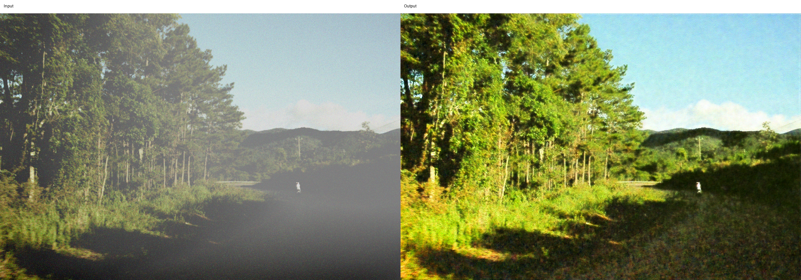
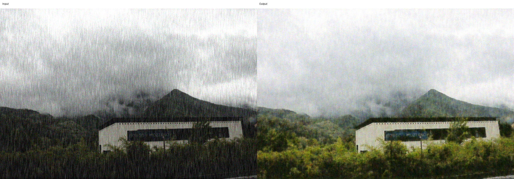
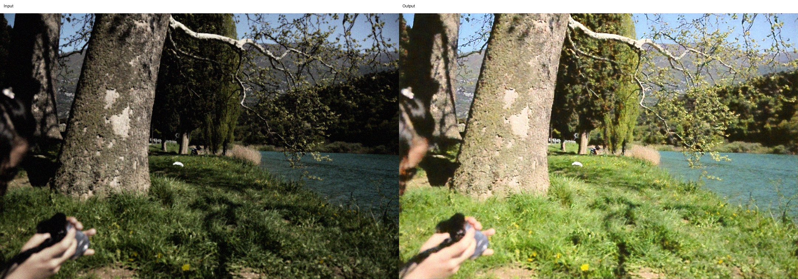
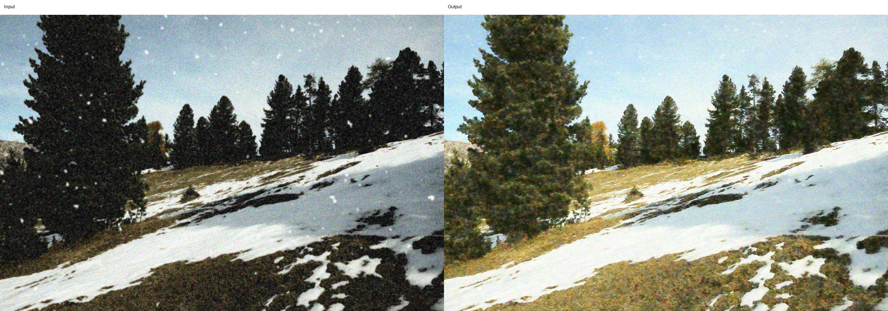
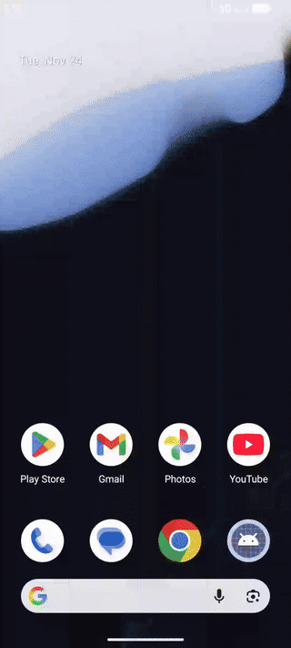

# WeatherEdgeMobile

**Diffusion-Distilled Image Restoration & On-Device Object Detection**

*From generative diffusion models to lightweight, deployable mobile vision.*

**PyTorch · DDPM / DDIM · Knowledge Distillation · Structural Re-parameterization · ONNX Runtime · Android · YOLO26n**

WeatherEdgeMobile is an end-to-end vision project that transfers image restoration knowledge from a conditional diffusion teacher into an ultra-lightweight student network and integrates the distilled model with YOLO26n for Android video object detection.

---

## 01. Diffusion-Guided Lightweight Image Restoration

### Teacher–Student Distillation Framework

**Stage 1 — Conditional Diffusion Teacher**

A conditional Denoising Diffusion Probabilistic Model (DDPM) learns to reconstruct clean images from degraded observations. The teacher uses a 1,000-step diffusion schedule during training, while 20-step DDIM sampling generates restoration targets for student distillation.

**Stage 2 — Knowledge Distillation**

A teacher–student training framework transfers restoration knowledge through:

- Diffusion-generated pseudo-target supervision
- Paired clean-image reconstruction objectives
- Edge-preserving restoration constraints
- Deterministic teacher-target caching

**Stage 3 — Lightweight Student Architecture**

A compact MobileIE-inspired encoder–decoder combines:

- Multi-branch re-parameterizable convolutions
- Feature self-transformation
- Lightweight dual-path attention
- Multi-scale feature extraction and fusion
- Structural re-parameterization for efficient inference

Unlike the diffusion teacher, the student performs deterministic image restoration in a **single forward pass**, without iterative diffusion sampling.

### Student Network Efficiency

| Metric | Lightweight Student |
|---|---|
| **Parameters** | **≈121K** |
| **Computational Cost** | **≈1.15 GMACs** |
| **Deployment Optimization** | Structural Re-parameterization |

*Convolutional MACs measured at 256 × 256 resolution.*

### Image Restoration Gallery

Selected qualitative restoration results from the CDD-11 test set. Each example shows the degraded input on the left and the restored output on the right.

| Haze Removal | Rain Removal |
|---|---|
|  |  |

| Low-Light Enhancement | Snow Removal |
|---|---|
|  |  |

---

## 02. On-Device Deployment & Object Detection

### Android Inference Pipeline

**Video Frames → MobileIE Student → SIMD-Optimized Preprocessing → YOLO26n → Optical-Flow-Assisted Tracking → Display**

The distilled restoration network is integrated into an Android application alongside a pretrained YOLO26n detector.

**ONNX Runtime Deployment**

Both restoration and object detection are deployed using ONNX Runtime, enabling Android CPU inference without requiring a Python runtime.

**Native SIMD Optimization**

Performance-critical image preprocessing is implemented in C++ with architecture-specific SIMD optimizations, including ARM NEON and x86 SSE2, reducing redundant image conversions and memory operations.

**Asynchronous Video Processing**

Video playback, model inference, and detection rendering are coordinated through an asynchronous processing pipeline.

**Optical-Flow-Assisted Detection Tracking**

Lucas–Kanade sparse optical flow and geometric motion estimation propagate detection boxes between inference updates, improving temporal continuity.

### Android Video Detection Demo

<p align="center">
  
</p>

*Android emulator demonstration of restoration-enhanced YOLO26n detection and optical-flow-assisted tracking.*

---

## Technical Highlights

| Area | Key Technologies |
|---|---|
| **Generative Image Restoration** | Conditional DDPM, DDIM Sampling, Multi-Scale Feature Learning |
| **Knowledge Distillation** | Teacher–Student Framework, Pseudo-Target Distillation, Edge-Preserving Supervision |
| **Lightweight Network Design** | MobileIE-Inspired Architecture, Feature Self-Transformation, Dual-Path Attention, Structural Re-parameterization |
| **Efficient Model Deployment** | ONNX Runtime, Single-Pass Inference, C++ SIMD, ARM NEON / SSE2 |
| **Mobile Object Detection** | YOLO26n, Optimized Preprocessing, Asynchronous Video Inference |
| **Video Tracking** | Lucas–Kanade Optical Flow, Geometric Motion Estimation, Temporal Box Propagation |

---

## Pretrained Models & Usage

Pretrained model weights are hosted separately to keep the source repository lightweight.

### Download Pretrained Models

The pretrained teacher, lightweight student, and Android deployment models are available from Baidu Netdisk.

**[Download WeatherEdgeMobile_Models.zip — Baidu Netdisk](https://pan.baidu.com/s/1HYPnyUDvzUD_Gz3fpJXVYQ?pwd=iiws)**

**Extraction Code: `iiws`**

| Model | Downloaded File | Destination |
|---|---|---|
| Diffusion Teacher | `teacher_best.pt` | `training/outputs/teacher/best.pt` |
| Lightweight Student | `student_best.pt` | `training/outputs/student/best.pt` |
| Android Restoration | `student_256.onnx` | `android/app/src/main/assets/student_256.onnx` |
| YOLO26n Detector | `yolo26n.onnx` | `android/app/src/main/assets/yolo26n.onnx` |

Rename `teacher_best.pt` and `student_best.pt` to `best.pt` after placing them in their respective directories. Create missing directories if necessary.

Model files are loaded locally and are not downloaded automatically.

### PyTorch Setup

```bash
cd training
pip install -e .
```

**Student inference**

```bash
python -m weatherdiff infer \
  --model student \
  --checkpoint outputs/student/best.pt \
  --input path/to/image.png \
  --output outputs/student_result.png \
  --device cpu
```

**Diffusion teacher inference**

```bash
python -m weatherdiff infer \
  --model teacher \
  --checkpoint outputs/teacher/best.pt \
  --input path/to/image.png \
  --output outputs/teacher_result.png \
  --sample-steps 20 \
  --device cpu
```

CUDA inference can be enabled with a compatible PyTorch/CUDA environment.

### CDD-11 Dataset

The restoration models are trained and evaluated on **CDD-11 (Composite Degradation Dataset)**, introduced in [OneRestore (ECCV 2024)](https://github.com/gy65896/OneRestore).

**[Download CDD-11 Dataset — Hugging Face](https://huggingface.co/datasets/gy65896/CDD-11)**

CDD-11 includes 11 degradation categories covering haze, rain, snow, low-light conditions, and their combinations.

Download and extract the dataset into the following structure:

```text
CDD-11/
├── train/
│   ├── clear/
│   ├── haze/
│   ├── rain/
│   ├── snow/
│   ├── low/
│   └── ... (composite degradations)
└── test/
    ├── clear/
    ├── haze/
    ├── rain/
    ├── snow/
    ├── low/
    └── ... (composite degradations)
```

For pretrained model evaluation, only the `test/` directory is required. Training from scratch additionally requires the `splits/train.txt` and `splits/val.txt` files used by this project's dataset loader.

The dataset is not redistributed in this repository.

### CDD-11 Evaluation

The CDD-11 dataset is not included in this repository. Download and prepare it separately before evaluation.

```bash
python -m weatherdiff evaluate \
  --model student \
  --checkpoint outputs/student/best.pt \
  --data-root /path/to/CDD11 \
  --split test \
  --recheck-images \
  --device cpu \
  --outdir outputs/eval_student
```

Per-category PSNR and SSIM results are saved to `outputs/eval_student/summary.csv`.

### Android Deployment

1. Download `student_256.onnx` and `yolo26n.onnx`.
2. Place both files in `android/app/src/main/assets/`.
3. Open `android/` in Android Studio.
4. Sync Gradle and run the application on an Android emulator or compatible Android device.

The ONNX models are loaded from the local application assets. They are not downloaded automatically at runtime.

